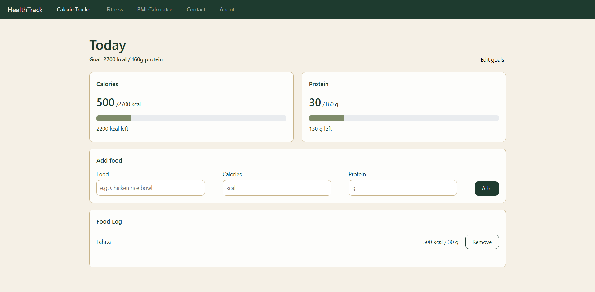
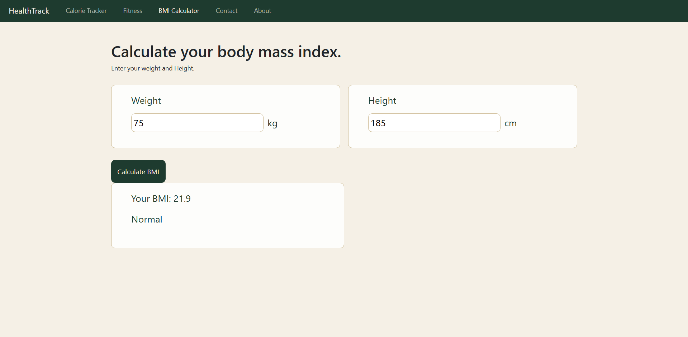
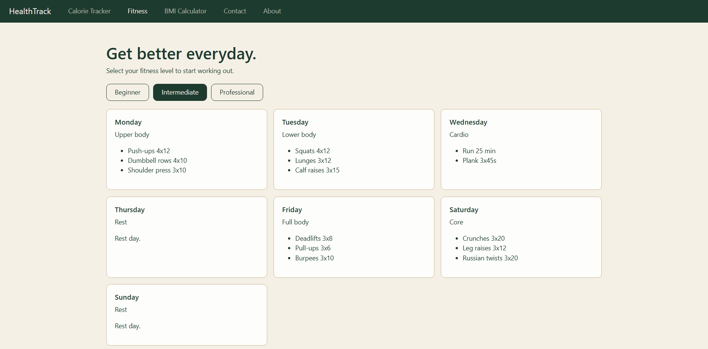
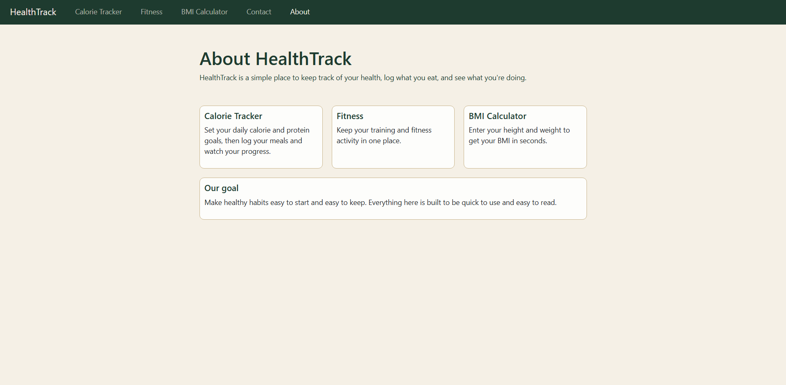
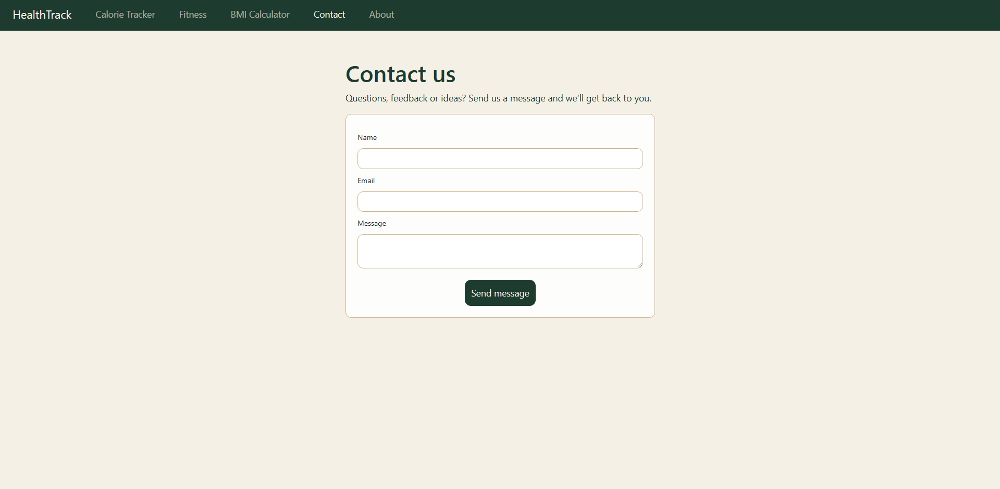

# HealthTrack

## 1. Project Description

HealthTrack is a health and fitness tracking website developed using React. It helps users monitor their daily calorie and protein intake, calculate their BMI, and learn more about fitness and healthy lifestyles.

### Features
- Calorie and protein tracker
- BMI calculator
- Fitness and workout guide
- About page
- Contact page

## Built With

- React
- Bootstrap

## 2. Setup Instructions

### Prerequisites
- Node.js
- npm

### Installation

1. Clone the repository:

   ```bash
   git clone https://github.com/SalahhShourr/health-track.git
   ```

2. Navigate to the project directory:

   ```bash
   cd health-track
   ```

3. Install the required dependencies:

   ```bash
   npm install
   ```

4. Start the development server:

   ```bash
   npm run dev
   ```

5. Open the local URL displayed in your terminal.

## 3. Screenshots of the UI

### Calorie Tracker


### BMI Calculator


### Fitness Page


### About Page


### Contact Page

